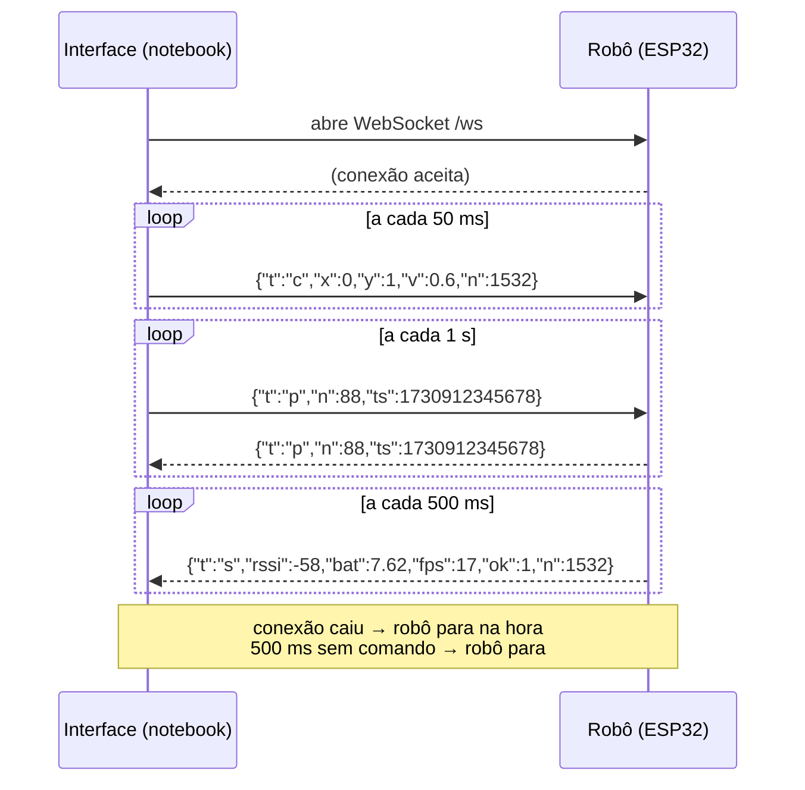

# Protocolo entre interface e robô

**Versão 0.1 (proposta, 20/10/2026).** Precisa ser aprovado pelo grupo. Toda mudança neste arquivo exige a mesma mudança no firmware (`firmware/`) e na interface (`interface/src/lib/protocol.ts`).

Este documento é o contrato entre quem escreve o firmware e quem escreve a interface. Com ele fechado, as duas frentes trabalham em paralelo e testam cada uma do seu lado: a interface contra o robô falso (`interface/tools/robo_falso.py`) e o firmware pelo monitor serial.

O diagrama dos módulos está em [`arquitetura.md`](arquitetura.md).

## 1. Visão geral

São três canais, todos pelo Wi-Fi que a própria ESP32 cria:

| Canal | Direção | Transporte | Endereço |
|---|---|---|---|
| Vídeo | robô → interface | HTTP, MJPEG | `http://192.168.4.1:81/stream` |
| Comandos, ping e status | nos dois sentidos | WebSocket, JSON em texto | `ws://192.168.4.1:80/ws` |
| Ajustes da câmera | interface → robô | HTTP GET | `http://192.168.4.1/control?var=…&val=…` |

O vídeo e os comandos andam separados de propósito: se o vídeo engasgar, o comando de parar continua chegando, e vice-versa.



## 2. Rede

| Item | Valor | Onde fica |
|---|---|---|
| Modo | Ponto de acesso (AP): a ESP32 cria a rede | `config.h` |
| Nome da rede (SSID) | `BALLOONE-G4` | `config.h` |
| Senha | Fica num `secrets.h` **fora do Git**, porque o repositório é público | `firmware/include/secrets.h` (no `.gitignore`) |
| IP do robô | `192.168.4.1`, o padrão do modo AP | — |
| Canal do Wi-Fi | 6 por padrão, configurável | `config.h` e mensagem `cfg` |

**Um operador por vez.** Se um segundo cliente abrir o WebSocket, o robô fecha o anterior e fica com o mais novo. Assim, quando a interface reconecta depois de uma queda, ela não fica presa atrás de uma conexão antiga que o robô ainda não percebeu que morreu.

## 3. Formato das mensagens

- Uma mensagem por quadro WebSocket, em JSON de texto, com até **256 bytes**. Mensagens maiores o robô descarta.
- O campo `t` diz o tipo. Campos desconhecidos são ignorados: assim dá para acrescentar campos sem quebrar quem ainda não os conhece.
- Números com no máximo 2 casas decimais. A mensagem fica menor e mais fácil de ler no monitor serial.
- JSON inválido é descartado em silêncio, dos dois lados. Uma mensagem estragada nunca pode travar o robô nem a interface.

### 3.1 `c`: comando de movimento (interface → robô)

```json
{"t":"c","x":0.4,"y":1,"v":0.6,"n":1532}
```

| Campo | Tipo | Faixa | Significado |
|---|---|---|---|
| `x` | número | −1 a 1 | Direção: −1 é esquerda, 1 é direita |
| `y` | número | −1 a 1 | Acelerador: −1 é ré, 1 é frente |
| `v` | número | 0 a 1 | Limite de velocidade do modo: precisão 0,3; normal 0,6; turbo 1; parar 0 |
| `n` | inteiro | cresce | Número de sequência. Serve para contar mensagens perdidas |

**Ritmo:** a interface manda a cada **50 ms** (20 Hz), **inclusive quando o comando é zero**. Fora da tela de pilotagem, e com a gaveta de ajustes aberta, ela manda sempre zero.

**O que o robô faz com o comando:**

1. Limita `x`, `y` e `v` às faixas acima.
2. Aplica zona morta: valores com |valor| < 0,08 viram 0.
3. Faz a mistura diferencial: `esquerdo = y + x` e `direito = y − x`, cada um limitado a ±1.
4. Multiplica por `v`, pela velocidade máxima (`vmax`) e pelo fator de compensação de cada motor (`ke`, `kd`).
5. Aplica a rampa: no máximo 10% de PWM a cada 20 ms.
6. Grava o instante do comando para o failsafe (seção 5).

**Autoteste dos motores:** não precisa de mensagem própria. Com `x = 0,5` e `y = 0,5`, só a roda esquerda gira (esquerdo = 1, direito = 0). Com `x = −0,5` e `y = 0,5`, só a direita. A interface manda isso por 500 ms quando o operador clica em "Girar".

### 3.2 `p`: ping (interface → robô → interface)

```json
{"t":"p","n":88,"ts":1730912345678}
```

| Campo | Tipo | Significado |
|---|---|---|
| `n` | inteiro | Número do ping |
| `ts` | inteiro | Hora do notebook em ms, quando o ping saiu |

**Ritmo:** 1 por segundo.

O robô **devolve a mensagem idêntica, na hora**, sem interpretar `ts`: os relógios do robô e do notebook são diferentes. A interface calcula `RTT = agora − ts`. Um ping sem resposta em 2 s conta como perdido, e o percentual de perda aparece na interface (T-03 e T-04).

### 3.3 `s`: status (robô → interface)

```json
{"t":"s","rssi":-58,"bat":7.62,"fps":17,"ok":1,"n":1532}
```

| Campo | Tipo | Significado |
|---|---|---|
| `rssi` | inteiro, dBm | Sinal do notebook visto pelo robô. Em modo AP, vem da lista de estações conectadas (`esp_wifi_ap_get_sta_list`) |
| `bat` | número, V | Tensão da bateria. **`0` quando o robô não tem sensor** (Opção A da pinagem): a interface mostra "sem sensor" em vez de alerta |
| `fps` | número | Quadros por segundo que o robô enviou no último segundo |
| `ok` | 0 ou 1 | 1 se está recebendo comandos; 0 se parou pelo failsafe |
| `n` | inteiro | Último número de sequência de comando recebido |

**Ritmo:** a cada **500 ms**. Se ficar mais de 1,2 s sem receber nada do robô, a interface mostra "sinal instável".

### 3.4 `cfg`: configuração (interface → robô) · **proposta, ainda não implementada**

```json
{"t":"cfg","ch":6,"vmax":0.8,"ke":1.0,"kd":0.95}
```

| Campo | Tipo | Faixa | Significado |
|---|---|---|---|
| `ch` | inteiro | 1 a 13 | Canal do Wi-Fi. Só vale depois de reiniciar o robô |
| `vmax` | número | 0,3 a 1 | PWM máximo. Com bateria de 7,4 V e motores de 6 V, até 0,8 |
| `ke` / `kd` | número | 0,8 a 1,2 | Fator de compensação dos motores esquerdo e direito, para o robô andar reto |

O robô aplica os valores na hora e os salva na memória da placa (biblioteca `Preferences`), para não precisar recompilar entre rounds. Na versão 0.1 ele **não confirma** o recebimento; a interface avisa isso ao operador.

## 4. Vídeo e câmera

### 4.1 Stream

- Endereço: `http://192.168.4.1:81/stream`. É o mesmo do exemplo CameraWebServer.
- Formato: `multipart/x-mixed-replace`. **Cada parte precisa do cabeçalho `Content-Length`**, porque o medidor de vídeo usa esse valor para separar os quadros e contar o FPS.
- O servidor precisa mandar `Access-Control-Allow-Origin: *`. Sem isso, o medidor não consegue ler o stream e o FPS recebido fica indisponível. O CameraWebServer já manda; o firmware próprio deve manter.
- O servidor aceita **um cliente de vídeo por vez**. A interface fecha a conexão sempre que troca de tela.
- Ponto de partida: QVGA, `jpeg_quality` 12, `fb_count` 2, `CAMERA_GRAB_LATEST`, com PSRAM. Os valores definitivos saem do T-01 e do T-02.

### 4.2 Ajustes da câmera

É o endpoint do próprio CameraWebServer: `GET /control?var=<nome>&val=<valor>`, na porta 80.

| `var` | Faixa | Uso na interface |
|---|---|---|
| `framesize` | QVGA = 5, HVGA = 7, VGA = 8 | Resolução. **Conferir esses números na versão instalada da biblioteca `esp32-camera` (`sensor.h`)** |
| `quality` | 10 a 63 | Qualidade JPEG: menor é melhor, e cada quadro fica maior |
| `brightness` | −2 a 2 | Brilho |
| `ae_level` | −2 a 2 | Exposição, para sol direto ou sombra |

## 5. Failsafe

São três camadas, todas obrigatórias:

| Camada | Evento | O robô faz | Como testar |
|---|---|---|---|
| 1. Ao ligar | Energizou ou reiniciou | Motores desligados **antes** de qualquer outra inicialização | Ligar com o robô no chão: ele não pode se mover |
| 2. Desconexão | O WebSocket fechou | Para na hora | Botão "Testar queda de conexão (3 s)" na interface (T-05) |
| 3. Silêncio | 500 ms sem comando `c` | Para e manda `ok: 0` no status | Desligar o Wi-Fi do notebook durante a pilotagem |

A interface também protege do lado dela:

- Quando a janela perde o foco (Alt+Tab, notificação, aba escondida), solta todas as teclas e manda comando zero.
- Se o Wi-Fi engasgar e o envio acumular mais de 1 KB, ela descarta comandos em vez de enfileirar. Comando atrasado é pior que comando perdido.
- Reconecta sozinha a cada 1 s e desiste de cada tentativa depois de 2,5 s.

## 6. Tempos

| Parâmetro | Valor | Onde fica |
|---|---|---|
| Envio de comando | 50 ms | `interface/src/config.ts` → `COMMAND_INTERVAL_MS` |
| Ping | 1 s | `PING_INTERVAL_MS` |
| Ping dado como perdido | 2 s | `interface/src/hooks/useRobot.ts` |
| Status do robô | 500 ms | `firmware/include/config.h` |
| Failsafe de silêncio no robô | 500 ms | `config.h` → `FAILSAFE_MS` |
| Interface considera sinal instável | 1,2 s sem mensagem | `STALE_AFTER_MS` |
| Reconexão | a cada 1 s | `RECONNECT_DELAY_MS` |

## 7. Como testar sem a placa

```bash
pip install websockets pillow
python interface/tools/robo_falso.py            # WebSocket em :8080/ws e vídeo em :8081/stream
python interface/tools/robo_falso.py --perda 0.05 --atraso 40   # rede ruim
```

Na interface: "Robô real", endereço `127.0.0.1` e, em Ajustes, porta do WebSocket 8080 e porta do vídeo 8081. O robô falso segue este documento. Ele mostra as rodas no terminal, conta os comandos perdidos e avisa quando o failsafe atua.

## 8. Pendências (cada uma vira um `docs/decisoes/D-xxx.md`)

1. **Onde o WebSocket roda.** O CameraWebServer já ocupa a porta 80 (`/control`) e a 81 (stream) com o servidor HTTP do ESP-IDF. Há duas opções:
   - **A.** Registrar `/ws` nesse mesmo servidor da porta 80, que tem suporte a WebSocket. Conferir se o core Arduino da versão escolhida vem com essa opção ligada.
   - **B.** Usar a biblioteca ESPAsyncWebServer em outra porta, por exemplo a 82. Nesse caso, mude a porta em Ajustes da interface e aqui.

   As duas bibliotecas na **mesma** porta não funcionam juntas.
2. **Mensagem `cfg`**: aprovar o formato e decidir se o robô deve confirmar o recebimento (`{"t":"ack","of":"cfg"}`).
3. **Leitura de bateria**: só existe na Opção B da pinagem (`config.h`). Na Opção A, o robô manda `bat: 0`.
4. **Política de um operador**: confirmar que "o mais novo derruba o anterior" é o comportamento desejado.
5. **JSON ou binário**: começar com JSON. Só passar para binário se o T-03 mostrar que o JSON pesa no RTT.

## Histórico

| Versão | Data | Mudança |
|---|---|---|
| 0.1 | 20/10/2026 | Primeira proposta, a partir do Guia da área de Software (seção 5.4) e da interface v1 |
